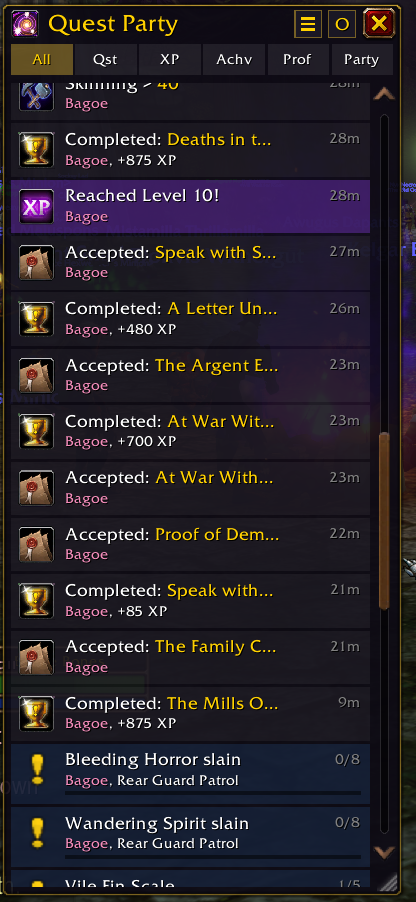
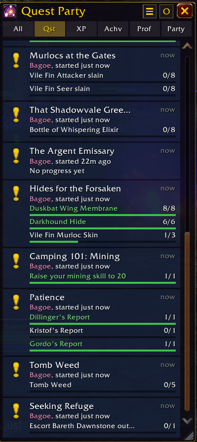
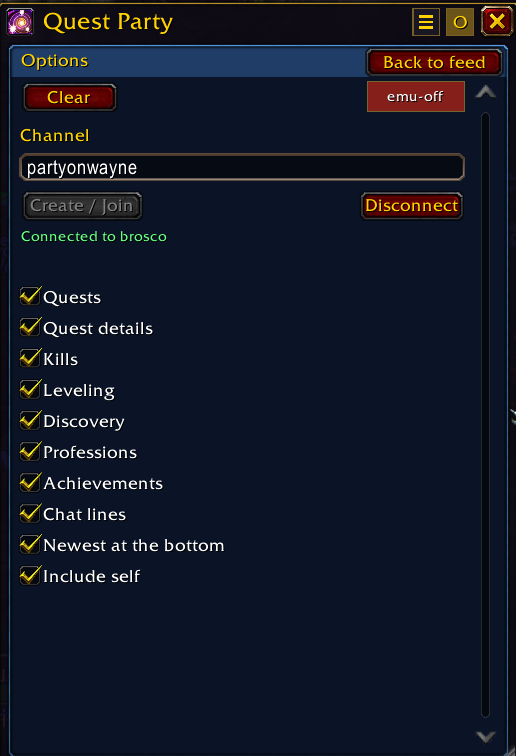

# Quest Party

Quest Party brings your adventures in **World of Warcraft: Forever** into one
compact, live feed. Follow quest objectives, level-ups, achievements, discoveries,
and profession gains without losing ongoing progress in a stream of chat.

- **Persistent quest cards** keep objectives and item counts visible across
  reloads, even without a channel connection. Your own quests refresh from your
  quest log; cached cards stay visible and turn gray after five minutes without
  an update.
- **Filter tabs** let you focus on quests, XP, achievements, professions, or the party view.
- **XP updates** show the amount gained, your current level, and the percentage
  remaining to the next level, with a progress bar. Control these with **Leveling**
  in Options.
- **Detailed and compact views** fit the way you like to track your adventures.
- **Customizable output** lets you choose event categories, include your own
  progress, and optionally show updates in your local chat window.

<p>
  
  
  
</p>

Quest Party is being built for social questing, so friends can follow each
other's adventures even when they are in different places. Create or join a
channel in Options, and everyone on it who runs Quest Party sees each other's
progress: your quests, levels, discoveries and the rest are posted to the
channel as you make them, and theirs show in your feed and as their quest cards.
When someone joins, everyone already there tells them where their quests stand,
so a newcomer's panel fills in at once without waiting for anyone to do
something. They travel as addon messages, the game's own way for addons to talk
to each other, so nothing is posted in the channel's chat. `/qp share`
says how much has been sent and received.

## Installation

Quest Party targets **WoW Forever**, using the `_forever_` game installation.

### Manual installation

Download `QuestParty-<version>.zip` from the
[latest GitHub release](https://github.com/codelab-chaos/quest-party/releases/latest)
and extract it into `World of Warcraft/_forever_/Interface/AddOns/`.
The ZIP already contains the `QuestParty` folder.

Launch WoW Forever, enable **Quest Party** in **AddOns**, and type `/qp` in game.

To update manually, replace the installed `QuestParty` folder with the folder
from the newer release ZIP.

### CurseForge installation (coming soon)

Quest Party is not yet available on CurseForge. Use the manual installation above
for now. The planned listing is [Quest Party on CurseForge](https://www.curseforge.com/wow/addons/quest-party/).

Once the listing and its Forever release are available:

1. Install and open the [CurseForge app](https://www.curseforge.com/download/app).
2. Select **World of Warcraft**, then choose your **Forever** installation from
   the game instance dropdown. If needed, add the game's `_forever_` folder.
3. Browse or search for **Quest Party**, then click **Install**.
4. Launch WoW Forever, enable **Quest Party** in **AddOns**, and type `/qp` in game.

See [CurseForge's WoW installation and game instance guide](https://support.curseforge.com/support/solutions/articles/9000198422-faq-and-troubleshooting)
if the app does not show the expected installation or addon.

## Getting started

Use the tabs beneath the title to choose a feed. The view button switches between
detailed quest cards and compact rows; **O** opens Options for event categories,
chat output, **Include self**, channel setup, and **Clear**. The emulator toggle
also appears in Options when debug mode is enabled. Type `/qp` again to hide or
show the panel.

Feed history and quest cards are saved across reloads. **Clear** removes that
saved history, the quest cards, and the player list; settings and channel
configuration are kept. Both the Options button and `/qp clear` explain this in
a confirmation dialog before deleting anything. Choose **Cancel** or press Escape
to keep the saved state.

## Slash commands

Enter these in WoW's chat input. `/questparty` also works in place of `/qp`.
Arguments in square brackets are optional.

| Command | What it does |
| --- | --- |
| `/qp` | Show or hide the panel. |
| `/qp help` | Print command help in your chat window. |
| `/qp set` | List the feature switches and their current values. |
| `/qp set <switch> [on/off]` | Turn a switch on or off; omit the last argument to toggle it. |
| `/qp share` | Say what has been sent on the channel, how much of it came back from the server (which shows it made the trip), what arrived from others, who is sharing, and whether the game refused anything. |
| `/qp clear` | Ask for confirmation before deleting saved feed history, quest cards, and the player list. Settings and channel configuration are kept. |
| `/qp icon [name-or-id]` | Set the title icon using an icon name, texture path, or numeric file ID. Omit the argument to restore the default icon. |
| `/qp debug [on/off]` | Enable or disable debug mode; omit the argument to toggle it. |

Available switches: `quests`, `questDetails`, `kills`, `levels`, `discovery`,
`professions`, `achievements`, `chatEcho`, `chatOrder`, and `showSelf`.

For example, `/qp set showSelf off` turns off **Include self**,
`/qp set levels off` disables XP and level-up updates, and
`/qp set chatOrder off` puts the newest entries at the top.

### Debug commands

Enable debug mode with `/qp debug on` to use these commands. The emulator toggle
is also available in Options while debug mode is enabled.

| Command | What it does |
| --- | --- |
| `/qp emu` | Start or stop the sample party emulator. While you are connected to a channel, its pretend players are sent over it with the real protocol and shown only when the server sends them back, so it tests how your client picks up another client's messages. With no channel they are shown directly. |
| `/qp listen` | Show or hide the listener: a small window that lists the hidden messages on the channel as they pass, marked sent, came back, or from a player. It shows only Quest Party's own messages, since the game gives an addon nobody else's. |
| `/qp emu start` | Start the emulator. |
| `/qp emu stop` | Stop the emulator. |
| `/qp emu step` | Play the next sample entry once. |
| `/qp emu burst [n]` | Play sample entries immediately; defaults to 10. |
| `/qp emu speed [n]` | Set playback speed from 0.25× to 20×; defaults to 1×. |
| `/qp test` | Replay sample game events as your own character. |

## Builds and releases

Every push to `main` and every pull request runs Lua 5.1 syntax checks, addon
tests, packaging tests and an installable ZIP build. Download test builds from
the **Checks and package** workflow's `QuestParty-build` artifact on the
[Actions page](https://github.com/codelab-chaos/quest-party/actions).
These builds do not publish a release.

When a version is ready to mark for release, open **Actions → Release → Run
workflow**, select `main`, and enter a version such as `0.1.0`. The workflow
runs all checks, stamps the version into the packaged TOC, creates the `v0.1.0`
tag at the tested commit, and publishes a **GitHub Release** with the
installable ZIP, SHA-256 checksum and generated release notes. These downloads
are visible on GitHub and can be shared for testing. This does not upload to
CurseForge. The working source's version is not changed by packaging. Update
its TOC version when starting a new version. Stable version tags become the
**Latest** release, visible in the repository sidebar. Tags with a suffix such
as `v0.2.0-rc.1` are marked as prereleases instead.

Alternatively, push an explicit version tag:

```sh
git tag -a v0.1.0 -m 'Quest Party 0.1.0'
git push origin v0.1.0
```

A failed check prevents publication. If a tag-triggered release fails before
publication, fix the issue in a new commit and use a new version, or re-run the
failed workflow if it was a temporary infrastructure failure. Existing release
assets are not overwritten. Pushing ordinary commits never deploys a release.

CurseForge publishing is planned for later. Follow
[Synthborn Terrascape's release pipeline](https://github.com/codelab-chaos/synthborn-terrascape/blob/main/.github/workflows/release-candidate.yml)
when connecting it: upload the same tested release archive after the GitHub
Release succeeds, and record the upload to avoid duplicates. No CurseForge
upload workflow or credentials are configured here yet.

## Local checks

From this project folder, with Lua 5.1 and Python 3.9 or newer installed:

```sh
find QuestParty tests -name '*.lua' -print0 | xargs -0 -n1 luac5.1 -p
lua5.1 tests/run.lua
python3 -m unittest discover -s tests -p 'test_*.py' -v
python3 scripts/package.py
```

The Lua tests exercise real addon modules with mocked game APIs: quest card
lifecycle, saves, filters, timeline ordering, event collection, kill-credit
pairing, local chat output, debug tools and transport throttling. They do not
run the game's frame renderer or prove live server API behavior.

Before tagging a public release, smoke-test in WoW: `/reload`, open and close
Options, change each filter, resize the panel, switch row views, enable
`/qp debug on`, and use the emu-on/off button in Options to preview a sample party.
Then run `/qp debug off` and confirm the emulator stops and its
button disappears. Channel sharing needs two characters on the same channel:
make progress on one, check it shows on the other, and check `/qp share` on both.
The tests cannot prove the server carries addon messages on a custom channel.
Check for Lua errors with `/console scriptErrors 1` before reloading.

For local installation, `scripts/deploy.sh` uses the AddOns path in
`.deploy-target` (ignored by Git) or `WOW_ADDONS_DIR`.

Local source installs start in debug mode, making the emulator button available
after every reload. `/qp debug off` hides it until the next reload. Packaged ZIPs
disable this development default; users can still opt in with `/qp debug on`.

## License

[MIT](LICENSE).
